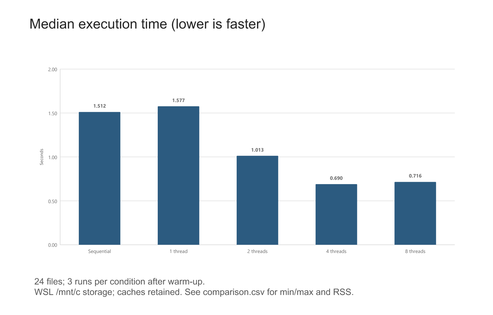

# LinuxProgramming

A reusable Linux traffic analyzer written in C11 with POSIX threads. It reads a directory of packet records, aggregates per-host and time-series statistics, and exports CSV reports. The same executable can analyze another day's data by changing the input path.

This repository contains the implementation, tests, project documents, presentations, and recorded validation results from a Linux system programming course project.

## Features

- Buffered input using `open()`, `read()`, and `close()`.
- Sequential execution and a configurable pthread worker pool.
- File-level work distribution with a mutex-protected queue.
- Per-worker hash tables followed by deterministic statistics merging.
- Per-IP transmitted and received traffic, Top-K hosts, and time-series statistics.
- Live progress updates approximately once per second, including completed files, bytes read, failed files, and elapsed time.
- Partial-result reporting for truncated or malformed input.

## Build and run

Use Linux or WSL with GCC, Make, pthreads, and Python 3 for the tests and experiment scripts. On Ubuntu, the required packages can be installed with:

```bash
sudo apt update
sudo apt install build-essential python3
```

```bash
git clone https://github.com/1oneSkad1/LinuxProgramming.git
cd LinuxProgramming/traffic_analyzer
make

./traffic_analyzer --input ../data/2026.08.02/pkt \
  --workers 4 --output results/run1
```

Provide a new output directory for each run. The program returns an error if the output directory already exists.

For sequential execution:

```bash
./traffic_analyzer --input ../data/2026.08.02/pkt \
  --mode sequential --output results/run1_sequential
```

Add `--quiet` to suppress progress and phase messages. Run `./traffic_analyzer --help` for all options.

## Input data

The analyzer supports the custom `pkt` binary format supplied for the course. Each record consists of a 12-byte little-endian storage header followed by the stored packet bytes, starting with an IPv4 header.

Download the data separately from the [course dataset directory](https://nmlab.korea.ac.kr/traffic.data/2026.08.02/). From the repository root, the following command downloads the packet directory to `data/2026.08.02/pkt`:

```bash
wget -c -r -np -nH --cut-dirs=1 -R 'index.html*' \
  -P data https://nmlab.korea.ac.kr/traffic.data/2026.08.02/pkt/
```

The input files must have finished downloading before analysis starts. Raw packet data, generated run directories, and compiled binaries are excluded from Git.

## Output

| File | Contents |
|---|---|
| `summary.csv` | Overall status, file counts, packet counts, byte counts, and unique hosts |
| `hosts.csv` | Transmitted and received packets and bytes for every IPv4 host |
| `top_hosts.csv` | Hosts ranked by combined transmitted and received bytes |
| `timeseries.csv` | Packet and byte counts grouped by time interval |
| `run_metrics.csv` | Execution options, elapsed time, throughput, and peak memory |
| `errors.log` | Failed input files, first error offsets, and reasons |

## Validation and recorded results

The current automated suite has 14 tests covering analytical correctness, sequential/parallel equivalence, malformed and truncated records, buffer boundaries, output handling, progress updates, and quiet mode. The suite also passes AddressSanitizer and UndefinedBehaviorSanitizer.

```bash
cd traffic_analyzer
make test
make sanitize
```

Full-day validation on the August 2, 2026 dataset processed 1,440 files and aggregated 225,206,700 valid IPv4 packets across 13,498 unique hosts. Sequential and four-worker analytical CSV files and error logs matched exactly. Three representative files were also checked against an independently implemented Python parser.

The recorded benchmark used 24 files sampled across the day, with one warm-up and three measured runs per condition on WSL2 using `/mnt/c` storage and eight logical CPUs.

| Execution mode | Workers | Median time (s) | Speedup vs. sequential |
|---|---:|---:|---:|
| Sequential | 1 | 1.512 | 1.00x |
| Threaded | 1 | 1.577 | 0.96x |
| Threaded | 2 | 1.013 | 1.49x |
| Threaded | 4 | 0.690 | 2.19x |
| Threaded | 8 | 0.716 | 2.11x |

Four workers had the shortest median in this sample and are the program's default. Four- and eight-worker timing ranges overlap. Re-measure when the data distribution, machine, or storage changes. The recorded experiments predate the live-progress feature. New benchmark runs use `--quiet` to reduce display overhead.



### Known issue in the supplied dataset

The source file `pkt_2026.08.02_19.27` ends with a record that requests 28 stored bytes but contains only 25. Its local and server SHA-256 values match. Full-day analysis retains the valid prefix, skips the incomplete final record, records the error, and exits with status `partial` and code `1`.

The checksum evidence and full-day results are included under `docs/results/full_day/`. Recorded logs and metadata retain paths from the original WSL environment.

## Repository layout

```text
traffic_analyzer/             C implementation, tests, and experiment scripts
docs/project_plan.md          Project plan in Korean
docs/implementation_report.md Implementation and validation report in Korean
docs/presentations/           Goal report and team presentation with speaker notes
docs/results/full_day/        Recorded full-day analytical outputs and validation
docs/results/benchmark/       Recorded benchmark runs, comparison, and chart
reference/pkt_checker/        Course-provided format reference source
```

The [analyzer guide](traffic_analyzer/README.md) describes the CLI, binary format, statistics, error behavior, and experiment reproduction. The [implementation report](docs/implementation_report.md) records the measurements and limitations. The [team presentation with speaker notes](docs/presentations/parallel_traffic_analyzer_with_notes.pptx) explains the project for group discussion.

## Format reference attribution

The original checker sources in `reference/pkt_checker/` were supplied through the course dataset site and retain their original author headers, including credit to Myung-Sup Kim. They document the input format used by the analyzer. The analyzer implementation is maintained separately in `traffic_analyzer/`.
